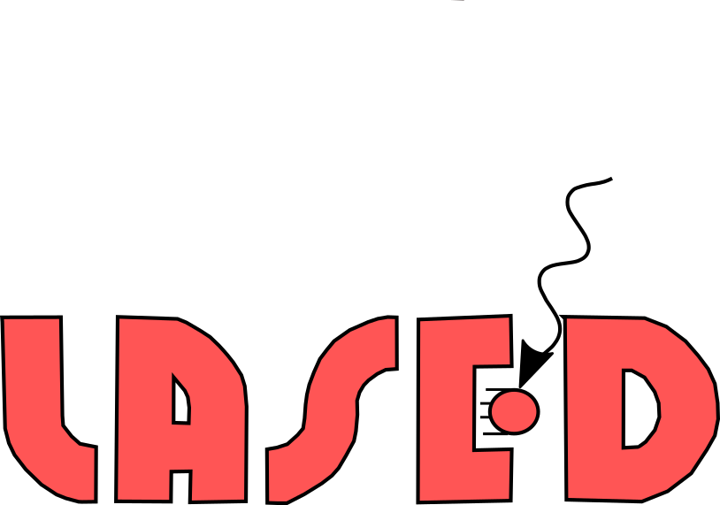

# LASED: Laser Atom interaction Simulator derived from quantum ElectroDynamics


LASED simulates lasers driving real multi-level atoms (fine, hyperfine and Zeeman structure) by solving
the Lindblad master equation for the full density matrix. It is built for atomic physics and
neutral-atom quantum-computing work: shaped and chirped pulses, several lasers (Λ, ladder and Rydberg
two-photon schemes), arbitrary (elliptical) polarisation, spontaneous decay with the correct branching
and coherence transfer, Doppler and beam-profile ensembles, and moving atoms. A compiled Rust backend
keeps it fast.

**Using LASED from an AI agent?** Read [AGENTS.md](AGENTS.md): units, conventions, API cheat sheet,
recipes and validation checks on one page.

## Installation

```
pip install LASED
```

To build from source you need a [Rust toolchain](https://rustup.rs). Run `pip install .`, or for
development `pip install maturin && maturin develop --release`. Without the compiled extension,
LASED falls back to SciPy automatically (check with `LASED.backendInfo()`).

## Quick start

```python
import numpy as np
import LASED as las

wavelength = 422.8e-9                                                    # Ca 1S0 -> 1P1
G = las.generateSubStates(label_from=1, w=0, L=0, S=0)
E = las.generateSubStates(label_from=2, w=las.angularFreq(wavelength), L=1, S=0)

calcium = las.LaserAtomSystem(E, G, tau=4.6, laser_wavelength=wavelength, laser_intensity=100,
                              polarisation=las.elliptical(angle=0, ellipticity=0.3))
rho = calcium.timeEvolution(np.linspace(0, 50, 501),
                            pulse=las.pulses.gaussian(t0=20, fwhm=10),     # optional time dependence
                            detuning=2*np.pi*0.1)                           # Grad/s (= 100 MHz)
print(rho.shape, calcium.excited_population[-1])                            # (501, 4, 4) ...
```

Several lasers, decay channels and losses (here a Rydberg ladder):

```python
red  = las.Laser(lower=S, upper=P, wavelength=780.24e-9, rabi=2*np.pi*0.1,
                 polarisation=las.circular(+1), detuning=2*np.pi*2.0)
blue = las.Laser(lower=P, upper=R, wavelength=479.6e-9, rabi=2*np.pi*0.1,
                 polarisation=las.circular(-1), detuning=-2*np.pi*2.0)
atom = las.AtomicSystem(S + P + R, lasers=[red, blue],
                        decays=[las.Decay(P, S, tau=26.24)], losses=[las.Loss(R, tau=150e3)])
rho = atom.evolve(time, rho0)
```

See [`examples/`](examples) for runnable scripts and the [documentation](https://lased.readthedocs.io/en/latest/)
for tutorials.

## What it can do

- **Time evolution** of any set of sub-states coupled by **any number of lasers**. Each laser has its
  own polarisation, intensity or Rabi frequency, detuning, **complex pulse envelope** (amplitude and
  phase), **time-dependent detuning** (chirps, adiabatic rapid passage) and linewidth.
- **Arbitrary polarisation**, including elliptical light, with helpers `linear`, `circular`,
  `elliptical` and `jones`.
- **Spontaneous decay** through Lindblad jump operators: correct branching ratios, Zeeman and hyperfine
  coherence transfer, extra loss channels (`tau_f`, `tau_b`, `Loss`) and dephasing.
- **Ensembles**: Doppler (thermal velocity) and Gaussian beam-profile averaging, run in parallel.
  **Moving atoms**: trajectories become time-dependent Rabi frequency and Doppler shift.
- **Steady states**, linear **Zeeman shifts**, **rotations** of the density matrix (Wigner D-matrices),
  the **angular shape** of the electron cloud, and **symbolic equations of motion** (sympy, LaTeX/PDF).
- An exportable description of the system (`describe()` returns JSON-ready output), plus direct access
  to the Hamiltonian and Liouvillian.

## Performance

The equations are assembled from vectorised sparse superoperators with cached Wigner coefficients.
They are solved with an exact matrix-exponential propagator for continuous-wave problems, or with the
Rust backend (PyO3, adaptive Dormand–Prince, parallel over ensemble members with rayon) for pulses and
ensembles. Before solving, LASED drops the density-matrix elements that the initial state cannot reach.

| Problem | v1.0 | v2.0 |
|---|---|---|
| Ca, Doppler-averaged (Tutorial 1) | 2.5 s | 0.02 s |
| He J=2→1, σ± light (Tutorial 2) | 16 s | 0.04 s |
| Cs D2, 48 states (Tutorial 6) | > 35 min (did not finish) | ~3 s |
| Rb-87 D2 shaped and chirped pulse | not possible | 0.5 s (Rust) vs 83 s (SciPy fallback) |

Timings were measured on a 4-core cloud VM.

## Version History

**v2.0**
- **Fixed:** complex Rabi factors (elliptical light) gave unphysical, ever-growing populations. The
  Hamiltonian is now Hermitian by construction: the ground←excited coupling uses Ω*.
- **Fixed:** spontaneous emission now transfers Zeeman and hyperfine coherences correctly. Before, this
  was wrong for any light mixing σ+ and σ−. Decay is built from Lindblad jump operators.
- **Fixed:** Doppler- and beam-averaged runs stored ρ_eg in place of ρ_ge.
- **Fixed:** support for current NumPy and SciPy (`np.complex` and `sph_harm` were removed), and
  half-integer `m` in `generateSubStates` and rotations.
- **New:** general `AtomicSystem` engine with several lasers (`Laser`), decays (`Decay`), losses (`Loss`)
  and dephasing (`Dephasing`).
- **New:** time-dependent pulses, phases and chirps (`LASED.pulses`), moving atoms, ensembles,
  `steadyState()`, Zeeman shifts, and `describe()`.
- **New:** Rust backend (PyO3/maturin) and `pyproject.toml` packaging; tests including an independent
  QuTiP cross-check; `AGENTS.md`.

**v1.0**
- Can plot the `angularShape` of the excited or lower atomic state's electron cloud for all simulation time.
- Increased speed of the `timeEvolution` by a factor of 2.

**v0.4**:
- Ability to model decay to other states not coupled to by the laser (e.g. non-radiative decay) using the keyword `tau_b` when instantiating the laser-atom system.
- Can export the symbolic printing of the equations of motion as a .tex and/or a .pdf file file using the keyword `pretty_print_eq_tex = True` and `pretty_print_eq_pdf = True` when performing a `timeEvolution` but the keyword `pretty_print_eq_filename` must be given a string to give the new file(s) a name. Note: to export to pdf `pdflatex` must be installed on your system to convert the .tex file to a .pdf file.

## Roadmap

See [ROADMAP.md](ROADMAP.md) and the research notes in [docs/research](docs/research). Next on the list
are two-atom Rydberg blockade gates, laser-noise spectra, error-budget bookkeeping and atomic-data presets.

## Further Reading

- A paper on this simulator can be found here: https://arxiv.org/abs/2203.12535.

## Acknowledgements

Thank you to Professor Andrew Murray, Dr Matthew Harvey, and Parinya Udommai for their continued support with this library and project.

Please cite this library if you are using it using the paper found here: https://arxiv.org/abs/2203.12535.
